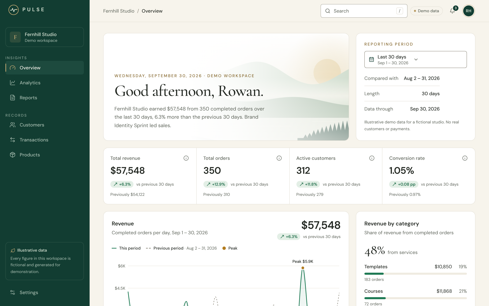
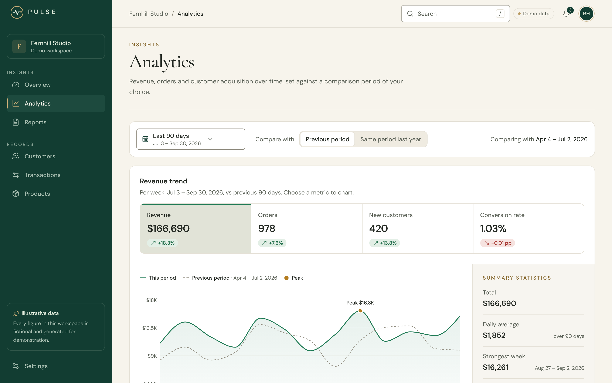
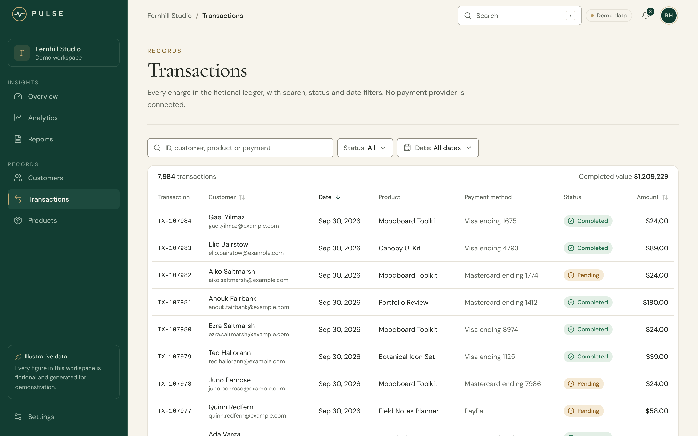
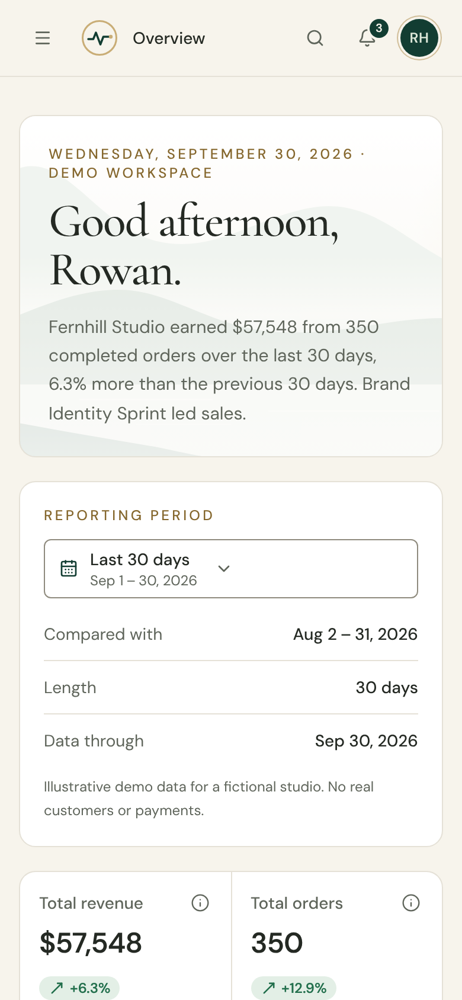

# PULSE

PULSE is a SaaS analytics workspace for a fictional design studio, built as a **self-initiated portfolio concept**. It
covers revenue, customers, transactions, products, reports and settings, all running on generated demo data.

> Every metric, customer and transaction in PULSE is illustrative. There is no backend, authentication, payment
> provider or live integration, and no data leaves the browser.



| Analytics | Transactions | Mobile |
| --- | --- | --- |
|  |  |  |

More: [dark mode](docs/screenshots/overview-dark.png) · [reports](docs/screenshots/reports.png) ·
[products](docs/screenshots/products.png) · [settings](docs/screenshots/settings.png) ·
[case study](docs/case-study.md) · [full specification](PROJECT_SPEC.md)

## What's inside

| Page | Highlights |
| --- | --- |
| **Overview** | Headline sentence, period picker with a comparison period, four KPIs with definitions, revenue trend, revenue by category, revenue against expenses, acquisition by channel, recent transactions, top products |
| **Analytics** | Metric selector, summary statistics, period comparison, channel breakdown, transaction volume by outcome |
| **Reports** | Report preview for any period, plus four CSV exports generated in the browser that match the preview row by row |
| **Customers** | Search, status filter, sorting, pagination, detail drawer |
| **Transactions** | Search, status and date filters, sorting, pagination, detail drawer |
| **Products** | Leader cards, search and sort, comparison with the previous period by revenue, units or conversion |
| **Settings** | Workspace name (validated), theme, display currency, default date range, chart animation, notifications |

The shell has a responsive sidebar and mobile drawer, workspace search (press <kbd>/</kbd>), a notifications menu, and
light and dark themes that apply before the first paint.

## Stack

Next.js 16 (App Router, Cache Components) · React 19 · TypeScript (strict) · Tailwind CSS 4 · Radix UI primitives ·
Recharts · Lucide icons · Vitest · Playwright · axe-core

## Getting started

Requires **Node.js 22** or later.

```bash
npm ci
npm run dev          # http://localhost:3000
```

There are no environment variables, API keys or services to configure.

## Commands

| Command             | Purpose                                              |
| ------------------- | ---------------------------------------------------- |
| `npm run dev`       | Start the development server                         |
| `npm run build`     | Production build                                     |
| `npm run start`     | Serve the production build                           |
| `npm run typecheck` | Generate route types and run `tsc --noEmit`          |
| `npm run lint`      | ESLint                                               |
| `npm run test`      | Unit tests (Vitest)                                  |
| `npm run e2e`       | Browser and accessibility tests (Playwright + axe)   |
| `npm run check`     | Typecheck, lint, unit tests and build                |

`npm run e2e` serves the production build on port 3100, so run `npm run build` first. Set `PORT` to use another port,
and set `PLAYWRIGHT_CHROMIUM_EXECUTABLE` to use an already-installed Chromium instead of Playwright's own browser.

## Project structure

```
src/
  app/                 Routes: (workspace)/ holds the six pages and settings; also the root layout and 404
  components/
    layout/            Sidebar, top bar, mobile drawer, search, notifications, profile menu
    dashboard/         Overview panels
    analytics/  products/  reports/  records/  settings/
    charts/            Recharts wrappers, chart frame with summary and data table
    tables/  filters/  ui/  theme/  brand/
  data/                Seeded demo-data generator and product catalogue
  lib/                 View models, metrics, formatting, money, dates, CSV, settings (unit-tested)
  types/               Domain types
e2e/                   Playwright specs, including the axe accessibility scan
docs/                  Case study and screenshots
```

## How it works

**Rendering.** Pages are React Server Components rendered with Partial Prerendering. Each page's heading and frame are
prerendered, and the computed content streams in behind a skeleton. Client JavaScript is limited to charts, menus,
drawers, URL-bound controls and the settings form. Charts below the first screen are drawn only as the reader scrolls
near them.

**State in the URL.** Date range, comparison, filters, sorting, page and chart metric live in the query string, so
every view can be linked, refreshed and navigated with the back button.

**Demo data.** The dataset is generated on the server from a fixed seed (`src/data/generate.ts`), so every run
produces the same records and nothing depends on the current date.

- It covers 1 January 2024 to 30 September 2026 for the fictional Fernhill Studio.
- It's simulated in the order a real business works: daily traffic per channel converts into new customers,
  customers make purchases, and revenue, product performance, expenses and notifications all derive from that ledger.
- Names are random combinations, and every email uses the reserved `example.com` domain.

**Numbers.**

- Money is stored as integer cents. Ratios are fractions, and changes in a ratio are reported in percentage points.
- Metric definitions live in `src/lib/metrics.ts`.
- Unit tests check that chart series, KPIs, product and channel breakdowns, and report totals all reconcile with the
  underlying transactions.
- EUR and GBP are shown at fixed demo rates. The ledger itself is in US dollars.

**Settings** are stored in a first-party cookie in the browser, so the server can render the chosen currency and date
range on the first request. Nothing is sent to an account or remote service.

**CSV export** builds the file in the browser from the same rounded values as the preview. Fields are escaped per
RFC 4180 and guarded against spreadsheet formula injection, with a UTF-8 BOM and CRLF line endings for Excel.

## Accessibility

- Semantic landmarks and headings, and a skip link.
- Labelled controls, and validation messages tied to their fields.
- Visible focus on every control.
- Keyboard-operable menus, dialogs and drawers, with focus returned on close.
- Status is never shown by colour alone.
- Reduced motion is respected, with a separate setting to switch chart animation off.
- Every chart has a written summary and a data table.

**How it was checked:**

- `e2e/accessibility.spec.ts` runs axe-core's WCAG 2.2 A/AA rules on every route in light and dark mode, and on each
  overlay (drawers, date picker, notifications, search, a settings validation error), at desktop and phone sizes.
- Keyboard behaviour is covered by the feature specs.
- Layouts were also checked by hand at 375, 768, 1280 and 1440 px, and with forced colours.

Automated rules catch only part of what matters, and PULSE has not been tested with real assistive-technology users.

## Performance

Lighthouse 13.5 was run against the production build (`npm run build && npm start`) on a local machine. Each route was
run three times per preset, and the table shows the median.

| Route | Mobile: performance | Mobile: LCP / TBT / CLS | Desktop: performance | Accessibility · Best practices · SEO |
| --- | --- | --- | --- | --- |
| `/` Overview | 76 | 4.2 s / 400 ms / 0 | 97 | 100 · 100 · 100 |
| `/analytics` | 79 | 2.9 s / 704 ms / 0 | 99 | 100 · 100 · 100 |
| `/reports` | 89 | 3.0 s / 292 ms / 0 | 100 | 100 · 100 · 100 |
| `/customers` | 88 | 3.4 s / 316 ms / 0 | 100 | 100 · 100 · 100 |
| `/transactions` | 89 | 3.4 s / 177 ms / 0 | 100 | 100 · 100 · 100 |
| `/products` | 89 | 3.0 s / 336 ms / 0 | 100 | 100 · 100 · 100 |
| `/settings` | 89 | 3.0 s / 277 ms / 0 | 100 | 100 · 100 · 100 |

Measured on 13 October 2026. Every route scored 100 for accessibility, best practices and SEO on both presets.
Drawing off-screen charts only as the reader scrolls near them raised Overview's mobile score from 61 to 76 (total
blocking time 1,172 → 400 ms) and Analytics' from 69 to 79.

Scores depend on the machine and network. The mobile preset simulates a mid-range phone on a slow 4G connection with
a 4× slower CPU; most of its remaining cost is drawing the first chart. Run Lighthouse against your own deployment
before quoting these numbers.

## Deployment

The app is a standard Next.js server application with no environment variables.

- **Vercel:** import the repository; the defaults (`npm ci`, `next build`) work as-is.
- **Any Node.js 22 host:** `npm ci && npm run build && npm start` (set `PORT` as needed).

The build downloads the two Google fonts once and self-hosts them, so the build machine needs internet access. The
running app makes no external requests. `next.config.ts` sends baseline security headers (`nosniff`, a referrer
policy, `X-Frame-Options: DENY`, and a permissions policy). A strict Content-Security-Policy would need per-request
nonces and is not included.

## Scope

PULSE is a front-end demonstration. A production version would need authenticated sessions, server-side
authorization, tenant isolation, a database with access controls, server-side validation and a privacy review. All of
that is deliberately out of scope here.
